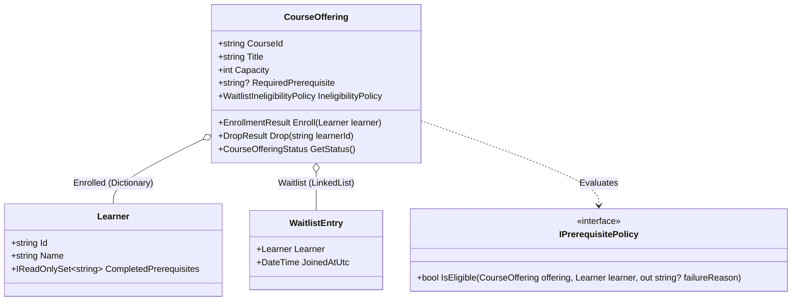

# Design Specification: Course Waitlist & Enrollment Service Slice

## 1. Executive Summary & Service Boundary
This document specifies the architecture, data models, invariants, and algorithmic rules for the bounded **Course Waitlist and Enrollment Service Slice**. The service models a single course offering's enrollment, drop, and FIFO waitlist promotion workflows.

### Bounded Scope:
* **In Scope**:
  * Enrollment into an offering with capacity tracking.
  * Ineligibility gating based on prerequisite verification.
  * Deterministic First-In, First-Out (FIFO) waitlist placement when full.
  * Automatic promotion of the earliest eligible waitlisted learner upon an enrolled learner dropping.
  * Rejection and idempotency handling for invalid, duplicate, or un-enrolled drop requests.
  * Thread-safe concurrency control ensuring invariant preservation under parallel operations.
* **Out of Scope (Anti-goals)**:
  * User interface / web frontend.
  * Multi-term course catalogs and curriculum graphs.
  * Payment gateways, billing, and identity authentication (OAuth/SSO).
  * Dynamic scriptable policy engines (rules are modeled declaratively via clean interfaces).

---

## 2. Domain Model & Data Structures

### Key Data Structures & Complexity:
* **Enrolled Store**: `Dictionary<string, Learner>` (Key: `LearnerId`, OrdinalIgnoreCase).
  * Lookups, enrollment, and drops are $O(1)$.
* **Waitlist Queue**: `LinkedList<WaitlistEntry>`.
  * Preserves exact FIFO arrival order.
  * Enqueue (joining waitlist): $O(1)$ at the tail (`AddLast`).
  * Promotion / Dequeue: $O(1)$ node removal upon locating candidate. Traversal is bounded by the size of the waitlist.
* **Concurrency Lock**: Dedicated synchronization root (`object _syncLock`) per course aggregate, ensuring serialized atomic transitions across reads and writes.

---

## 3. Core Domain Invariants

The service maintains the following core invariants across all operations:

1. **Capacity Invariant**:
   $$\text{EnrolledCount} \le \text{Capacity}$$
   The number of enrolled learners never exceeds the declared capacity under any sequence of concurrent or sequential operations.

2. **Uniqueness Invariant**:
   A learner can occupy at most one state in a course offering at any given moment:
   $$\text{Learner} \in \text{Enrolled} \oplus \text{Learner} \in \text{Waitlist} \oplus \text{Learner} \notin \text{Offering}$$
   No learner can be enrolled twice, waitlisted twice, or simultaneously enrolled and waitlisted.

3. **FIFO Order Invariant**:
   Waitlist positions are assigned strictly in ascending order of arrival ($\text{JoinedAtUtc}$). Promotion always evaluates candidate learners starting from the queue's head.

4. **Eligibility Invariant**:
   An ineligible learner is **never** enrolled directly and **never** promoted from the waitlist into an enrolled seat.

5. **State Non-Corruption Invariant**:
   Invalid requests (e.g., dropping a non-enrolled learner, empty IDs, duplicate drops) fail safely and immediately return descriptive result codes without mutating enrollment count, capacity, or waitlist order.

---

## 4. Policy Definition & Waitlist Promotion Mechanics

### 4.1 Prerequisite Policy
A course offering may declare an optional prerequisite course code (e.g., `RequiredPrerequisite: "CS-101"`).
* If `RequiredPrerequisite == null`, any learner is considered eligible.
* If `RequiredPrerequisite != null`, the learner is eligible if and only if `learner.CompletedPrerequisites.Contains(RequiredPrerequisite)`.
* Custom criteria (academic holds, GPA gates) are supported via the extensible `IPrerequisitePolicy` interface.

### 4.2 Waitlist Ineligibility Handling: "Skip and Retain" (Default Policy)
When an enrolled learner drops, a seat opens. The service examines the waitlist from head to tail:
1. **Eligible Candidate at Head**:
   * Removed from the waitlist and enrolled immediately.
2. **Ineligible Candidate Encountered**:
   * **Policy: `SkipAndRetain`**: The ineligible learner is bypassed for the current seat and **retains their position at the waitlist**, allowing them the opportunity to fulfill their prerequisite before future seats open. The service inspects the next learner in FIFO order.
   * **Policy: `SkipAndEvict`** (Configurable alternative): The ineligible learner is evicted from the waitlist upon evaluation.
3. If no waitlisted learner is eligible, the seat remains open ($\text{AvailableSeats} = 1$).

---

## 5. Concurrency & Persistence Strategy

### Concurrency
* Synchronization is applied at the course offering aggregate boundary using standard C# mutual exclusion (`lock (_syncLock)`).
* This provides:
  * Race-condition immunity during simultaneous enrollment requests when seats are limited.
  * Prevention of duplicate enrollments when identical learner IDs attempt to enroll in parallel.
  * Atomic drop-and-promote transitions, ensuring no newly arriving enrollment can hijack a seat that belongs to a waitlisted student.

### Persistence
* Designed as an in-memory repository (`ConcurrentDictionary<string, CourseOffering>`) in `CourseEnrollmentService`.
* Decoupled from storage infrastructure to adhere to scope boundaries while enabling straightforward replacement with an EF Core / relational database repository if needed.

---

## 6. Assumptions & Trade-offs

| Decision | Trade-off / Rationale |
|---|---|
| **In-Memory Store vs SQL Database** | In-memory store satisfies scope boundaries and avoids unnecessary external database infrastructure while providing sub-millisecond execution for unit/integration/concurrency tests. |
| **`SkipAndRetain` Policy** | Preserves student priority when delays in grade submission or prerequisite validation occur, while keeping course seats filled without bottlenecking. |
| **Result Objects vs Exceptions for Domain Flow** | Returns explicit `EnrollmentResult` and `DropResult` objects instead of throwing exceptions for anticipated business states (e.g., `AlreadyEnrolled`, `Waitlisted`, `LearnerNotEnrolled`), reserving exceptions strictly for programming errors and contract violations. |

